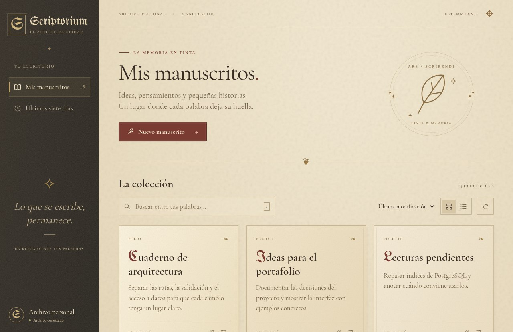
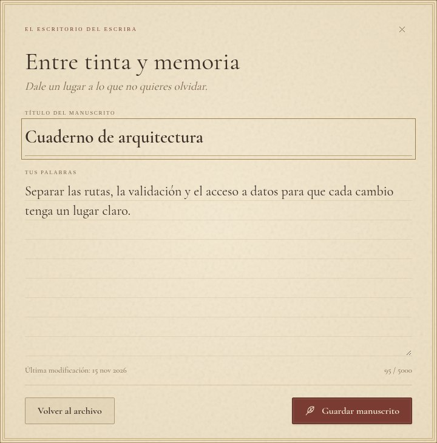

# Scriptorium · Notes API

Un cuaderno digital inspirado en los manuscritos medievales. Escribe sobre pergamino, vuelve a tus ideas con una búsqueda y organiza tus notas en un archivo de fácil consulta. La interfaz en español se conecta a una API REST construida con FastAPI y PostgreSQL.

[](https://www.python.org/)
[](https://fastapi.tiangolo.com/)
[](https://www.postgresql.org/)
[](app/frontend)
[](LICENSE)

[Inicio local](#inicio-local) · [Contrato de la API](Notes/api_contract.md) · [Modelo de datos](Notes/ERD.md) · [Descripción del sistema](Notes/SYSTEM_OVERVIEW.md)

## Vista previa

Capturas del archivo y del editor con notas de ejemplo. Abre cualquiera para verla a tamaño completo.

| Archivo de manuscritos | Editor |
| :---: | :---: |
| <a href="Notes/assets/scriptorium-archivo.jpg"></a> | <a href="Notes/assets/scriptorium-editor.jpg"></a> |

## Qué puedes hacer

- **Escribir y revisar.** Crea, edita y elimina notas desde el archivo.
- **Encontrar una idea.** Busca por título o contenido, filtra notas recientes y ordena por fecha o título.
- **Cambiar de vista.** Alterna entre cuadrícula y lista; pulsa `/` para ir al buscador.

## Cómo está hecho

| Capa | Tecnología y responsabilidad |
| --- | --- |
| Interfaz | HTML, CSS y JavaScript para el archivo, el editor y la búsqueda. |
| API | FastAPI y Pydantic para las rutas y la validación de datos. |
| Persistencia | SQLAlchemy y psycopg para guardar las notas en PostgreSQL. |

El proyecto está pensado como un cuaderno de uso local, sin cuentas de usuario. Los controles `/health` y `/health/db` permiten consultar el estado de la API y de la conexión a PostgreSQL.

## Inicio local

Necesitas Python 3.12+ y PostgreSQL 16+. Crea una base llamada `notes_db` y un usuario con permisos sobre ella. Ejecuta `database/schema.sql` en esa base. Puedes cargar `database/seed.sql` si quieres datos iniciales.

Desde la raíz del repositorio:

```bash
cp .env.example .env
# Ajusta DATABASE_URL con tu usuario, contraseña y puerto de PostgreSQL.
python3 -m venv .venv
source .venv/bin/activate
pip install -r app/backend/requirements.txt
cd app/backend
uvicorn main:app --reload --port 8000
```

En otra terminal, desde la raíz del repositorio:

```bash
python3 -m http.server 5173 --bind 127.0.0.1 --directory app/frontend
```

[Abre Scriptorium](http://127.0.0.1:5173/) o consulta [Swagger UI](http://127.0.0.1:8000/docs).

## Rutas principales

| Método | Ruta | Acción |
| --- | --- | --- |
| GET | `/notes` | Listar notas |
| POST | `/notes` | Crear una nota |
| GET | `/notes/{id}` | Consultar una nota |
| PUT | `/notes/{id}` | Actualizar una nota |
| DELETE | `/notes/{id}` | Eliminar una nota |

## Licencia

Distribuido bajo la [GNU GPL v3.0](LICENSE).
